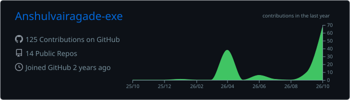
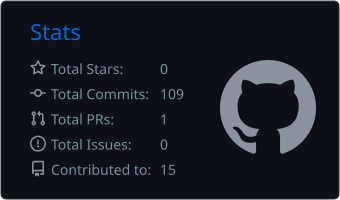
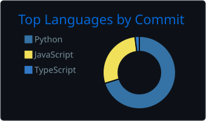

<div align="center">



<a href="https://git.io/typing-svg"></a>

<p>
  <a href="https://www.linkedin.com/in/anshul-vairagade-15582b201/"></a>
  <a href="https://medium.com/@anshulvairagade13"></a>
  <a href="mailto:anshulvairagade13@gmail.com"></a>
  <a href="https://github.com/Anshulvairagade-exe/Portfolio"></a>
</p>


</div>

---

### `$ cat about_me.txt`

```yaml
name:      Anshul Vairagade
role:      Cybersecurity Student
location:  Nagpur, India
focus:
  - Penetration Testing & OSINT reconnaissance
  - Digital Forensics & Android (APK) analysis
  - Security Operations (SOC) & detection rules
  - Adversarial AI — why models fail, get fooled, and how to secure them
philosophy: "To secure a system, first understand how it breaks."
currently:  building offensive + defensive tooling and writing about it on Medium
```

---

### `$ ls ~/projects --featured`

<table>
<tr>
<td width="50%" valign="top">

#### 🛡️ [Pentest-project](https://github.com/Anshulvairagade-exe/Pentest-project)
Full-stack penetration testing platform with automated scanning, OSINT recon and OWASP-based vulnerability analysis.


</td>
<td width="50%" valign="top">

#### 📱 [APK-Inspector](https://github.com/Anshulvairagade-exe/APK-Inspector)
Upload an Android APK, auto-decompile it with open-source tools, and get a detailed report on metadata, permissions and risks.


</td>
</tr>
<tr>
<td width="50%" valign="top">

#### 🖥️ [Soc_for_lab](https://github.com/Anshulvairagade-exe/Soc_for_lab)
Custom SOC platform for lab monitoring — cross-platform agents, centralized rule engine, dashboard and local AI-style insights.


</td>
<td width="50%" valign="top">

#### 🧠 [AI-security-](https://github.com/Anshulvairagade-exe/AI-security-)
A developer's deep-dive into why AI systems fail, get fooled, or behave unexpectedly — the groundwork for securing them.


</td>
</tr>
<tr>
<td width="50%" valign="top">

#### 💸 [KarmaPay](https://github.com/Anshulvairagade-exe/KarmaPay)
Payments project built in TypeScript.


</td>
<td width="50%" valign="top">

#### 🌐 [Portfolio](https://github.com/Anshulvairagade-exe/Portfolio)
Personal portfolio covering Penetration Testing, Digital Forensics & Adversarial Research.


</td>
</tr>
</table>

---

### `$ which --all tools`

<div align="center">

**Languages & Dev**


**Security Toolkit**


</div>

---

### `$ ./stats --live`

<div align="center">







</div>

---

### `$ snake --eat contributions`

<div align="center">
  <picture>
    <source media="(prefers-color-scheme: dark)" srcset="https://raw.githubusercontent.com/Anshulvairagade-exe/Anshulvairagade-exe/output/github-snake-dark.svg"/>
    
  </picture>
</div>

---

<div align="center">

```
> "Every system is secure until someone gets curious."
```

<sub>⚡ Open to internships, CTF teams and security collaborations — reach out on LinkedIn.</sub>

</div>
